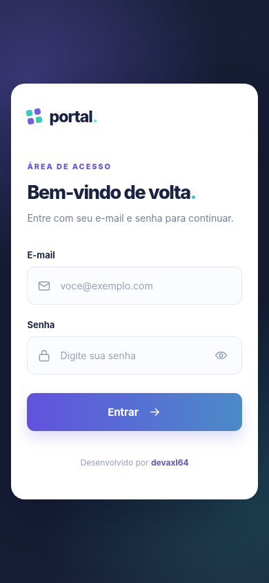
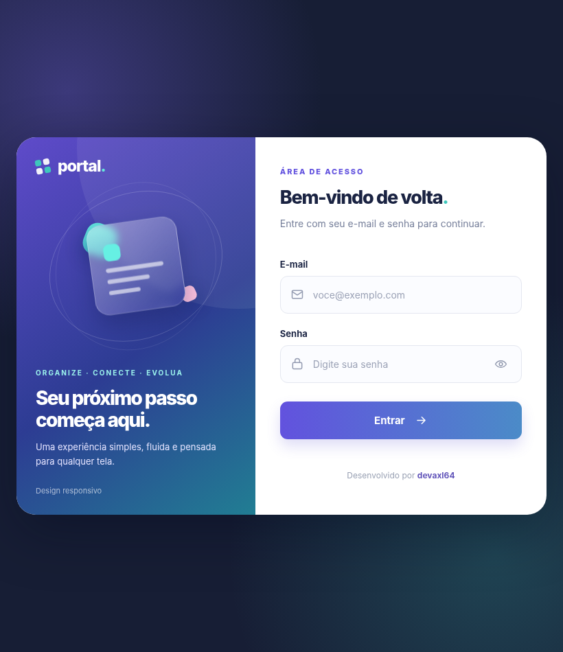
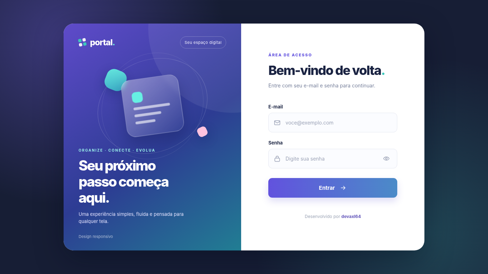

# Tela de Login Responsiva — Mobile First

Interface de login desenvolvida com **HTML, CSS e JavaScript**, adaptada para celular, tablet e desktop. Um projeto de estudos que evoluiu para uma apresentação visual de portfólio.

## Prévia

| Celular | Tablet | Desktop |
|:---:|:---:|:---:|
|  |  |  |

## O que o projeto demonstra

- Layout responsivo com CSS Grid e Media Queries.
- Organização de conteúdo e componentes em HTML semântico.
- Campos com validação nativa do navegador.
- Botão para mostrar ou ocultar a senha.
- Navegação por teclado e indicadores visuais de foco.
- Ajustes para telas menores e janelas com pouca altura.

## Tecnologias

**HTML5 · CSS3 · JavaScript** (sem frameworks).

## Como executar

Abra `index.html` em um navegador. Também é possível utilizar a extensão Live Server no VS Code.

**Observação:** o formulário é uma demonstração de interface. Ele valida os campos no navegador, mas **não autentica usuários nem envia senhas para um servidor**.

## Origem

Iniciado durante meus estudos de **HTML5 e CSS3 do Curso em Vídeo, com o professor Gustavo Guanabara**. Esta versão recebeu uma nova organização visual e ajustes de responsividade e usabilidade.

## Autor

**Axel Castro — devaxl64**  
[GitHub](https://github.com/devaxl64) · [Portfólio](https://devaxl64.github.io/Portif-lio/)
